# Especificação de piloto empresarial ATS

Data: 23/10/2026. **Especificação prospectiva, sem empresa participante, credencial nova, integração homologada ou candidatura de piloto executada.** Não altera produção. Complementa [o relatório de viabilidade](../RELATORIO-VIABILIDADE-AUTOMACAO.md).

## Escopo e autorização

O piloto terá uma empresa identificada, um tenant ATS, uma lista explícita de vagas e um responsável da empresa. A autorização precisa abranger captação pelo Empregatos, dados e currículos recebidos, operações de API, consulta de confirmação e tratamento de incidentes. A empresa confirma também que seu contrato com o ATS permite a integração. A adesão do candidato autoriza o compartilhamento com aquela empresa/vaga, sem substituir a autorização do destino.

O responsável configura a integração no ATS ou concede o OAuth empresarial efetivamente oferecido pelo fornecedor. Segredos entram por canal administrativo protegido e ficam em cofre do backend, com referência no cadastro da conexão. Não passam pelo perfil do candidato, consultas de URL, logs, ferramentas de IA ou mensagens da fila. Tokens não são extraídos de navegadores, código de páginas ou contas de outras empresas.

Proposta de cadastro interno, ainda não implementada: empresa/tenant, fornecedor, referência do segredo, concessões documentadas, vagas permitidas, responsável, data de autorização, estado da conexão e revogação. Não são nomes de parâmetros ou escopos de fornecedor.

## Caminhos oficiais possíveis

| Fornecedor / caminho | Autorização e permissões reais | Recepção das vagas | Submissão e confirmação |
|---|---|---|---|
| Gupy — captação externa comum | Master/administrador da empresa gera Bearer. Guia requer permissões V1 `[Input] Applications` e `[Input] Jobs` | Consulta autenticada das vagas da empresa, restrita à lista autorizada | Criação devolve `applicationId`; convite/complementação são estados separados. Confirmar o registro pela leitura autorizada e a conclusão pelo estado efetivo do processo |
| Gupy — API Candidatura Rápida | Guia exige endpoints completos V1/V2; exposição ampla precisa ser aceita pela empresa, não descrita como permissão estreita | Vagas da modalidade permitidas pela empresa; configuração e perguntas oficiais | `quick-apply` devolve IDs; conferir vínculo com empresa/vaga e respostas. Homologar leitura de confirmação; não equiparar `hasDisqualifyingAnswer: false` à aprovação |
| Greenhouse — Candidate Ingestion | Parceria com cliente em comum. OAuth empresarial com `jobs.view`, `candidates.create`, `candidates.view`; alternativa oficial Partner API Key + usuário de serviço/`On-Behalf-Of`, limitado às permissões desse usuário | Vagas acessíveis ao usuário empresarial autorizado | `POST /v1/partner/candidates`, com candidatura a vaga, não mero prospect sem vaga; IDs de pessoa/candidatura e `external_id`. Consulta autorizada retorna candidaturas, estágio e estado |
| Greenhouse — Job Board API | GETs públicos; POST com Job Board API Key fornecida pela empresa | Quadro publicado e configuração de perguntas | POST documentado da vaga. A interface Job Board não deve ser presumida como consulta completa de candidatura; contratar meio de reconciliação oficial antes do piloto |
| Lever — Postings API | Chave de submissão fornecida pela empresa, conforme contrato do fornecedor | GETs do site/quadro da empresa | Resposta documentada `ok: true` + `applicationId`. A página de consulta citada na documentação exige login empresarial. Se for necessária reconciliação por API, obter escopo/API oficial própria; não presumir que a chave Postings permita ler toda a base |
| Ashby | Chave empresarial com `candidatesWrite` para `applicationForm.submit` e `candidatesRead` para `application.info`; leitura da configuração/vagas conforme endpoints e concessões do tenant | Feed publicado ou API oficial de vagas aprovada; configuração do formulário da publicação | Validar resultado de negócio do envio e identificador da instância do formulário; consultar `application.info` pelo ID retornado, exigindo correspondência com a vaga |
| SmartRecruiters | Conexão de cliente/parceiro, endpoints protegidos; no OAuth, `candidate_applications_manage` | Posting API e vagas liberadas pela empresa | Configuration → criação em `/postings/:uuid/candidates` → consulta `/postings/:uuid/candidates/:candidateId/status`. Preservar avisos e consentimentos retornados |

Não se transfere OAuth empresarial para a conta pessoal do candidato. Uma empresa não autoriza vagas de outro tenant. Para o primeiro piloto, escolher **um** caminho que também ofereça confirmação e reconciliação suficientes; não implementar cinco integrações antecipadamente.

Fontes consultadas em 23/10/2026: [Gupy autenticação](https://developers.gupy.io/docs/autentica%C3%A7%C3%A3o-recrutamento-sele%C3%A7%C3%A3o), [captação externa](https://developers.gupy.io/docs/fluxo-de-capta%C3%A7%C3%A3o-de-pessoas-candidatas-em-plataformas-externas), [Gupy rápida](https://developers.gupy.io/docs/fluxo-de-capta%C3%A7%C3%A3o-de-pessoas-candidatas-em-plataformas-externas-candidatura-rapida), [Greenhouse Ingestion](https://docs.greenhouse.io/candidate-ingestion.html), [Greenhouse Job Board](https://docs.greenhouse.io/job-board.html), [Lever Postings](https://github.com/lever/postings-api), [Ashby envio](https://developers.ashbyhq.com/reference/applicationformsubmit), [Ashby consulta](https://developers.ashbyhq.com/reference/applicationinfo), [SmartRecruiters Application](https://developers.smartrecruiters.com/docs/application-api).

## Arquitetura e contratos internos

Reaproveitar os componentes do Empregatos que já fazem descoberta, avaliação, preparação, autorização, reserva, fila, diário de tentativa e confirmação. Um conector de parceiro será uma nova implementação atrás do roteamento normal, não um script de operador que envia currículos por fora.

```mermaid
flowchart LR
  E[Empresa autoriza tenant e vagas] --> C[Conexão empresarial]
  C --> D[Descoberta oficial]
  D --> F[Filtros e compatibilidade do candidato]
  F --> P[Preparação e consentimentos]
  P --> Q[Fila e reserva de tentativa]
  Q --> X[Executor autorizado do parceiro]
  X --> R[Confirmação e reconciliação]
  R --> H[Histórico com evidência]
```

Contrato interno proposto, não API de fornecedor: obter publicações autorizadas; obter requisitos/formulário; preparar entrada usando fatos aprovados; enviar uma única vez; consultar o registro existente; revogar conexão. Cada conector declara quais dessas capacidades oferece, quais evidências de recebimento aceita e quando pode comprovar uma rejeição sem gravação. Ausência de capacidade de reconciliação deve ficar explícita no produto.

A fila transporta IDs internos: conexão, workspace, vaga, execução e tentativa. O worker obtém o currículo aprovado de armazenamento privado somente depois de revalidar autorização e elegibilidade. Não enfileirar currículo, CPF, senha ou token. Upload, quando exigido, deve retornar um identificador válido antes de ser referenciado pelo envio.

Configuração mínima do fornecedor: tenant de destino confirmado, URL de API oficial fixa, grants, tipo de vaga, limites e versão do contrato. Não aceitar host arbitrário ou URL de currículo com acesso irrestrito. Se o ATS exigir download remoto, usar mecanismo de acesso temporário, restrito ao arquivo e ao período necessário, aprovado na homologação; remover depois.

## Preflight e transmissão

O worker confere que a conexão continua ativa; empresa, vaga externa e destino correspondem; publicação está aberta e na janela; filtros e qualificações são satisfeitos; currículo é o aprovado; todas as respostas obrigatórias e consentimentos estão disponíveis no escopo correto. Não converter lacuna de experiência em autorização para responder algo falso.

Consultar a versão atual do formulário. Registrar sua assinatura e versão do aceite, sem copiar respostas pessoais para o log. Perguntas novas ou mudança material de política devolvem a tarefa para preparação/ação do usuário. A disponibilidade de um dado pessoal não concede permissão para utilizá-lo em outra empresa ou vaga.

Reservar a tentativa atomicamente antes da chamada externa. Registrar início da transmissão antes de tocar o destino e capturar HTTP exato, código de erro permitido, nomes de campos rejeitados e IDs externos; sanitizar textos livres. Um retorno 2xx sem contrato de sucesso comprovado não produz “recebido”.

## Confirmação, incerteza e duplicidade

A chave lógica de deduplicação combina titular, fornecedor, tenant e identificador estável da vaga externa. O índice de identidades equivalentes cobre redescoberta da mesma publicação por várias fontes. A reserva deve sobreviver a reinício, reentrega da fila e múltiplos workers.

Usar chave de idempotência externa somente se documentada e homologada. Um `external_id` de correlação não é automaticamente uma chave idempotente. Sem garantia externa, diário atômico e reconciliação impedem retransmissão cega, mas não prometem execução exatamente uma vez através da rede.

Recebimento exige evidência do destino vinculada à empresa, vaga e tentativa: identificador retornado por contrato válido e, quando disponível, leitura posterior ou evento autenticado do ATS. Preservar resposta sanitizada, data, origem e revisão do executor. Registro como prospect, criação de convite, recebimento de currículo e conclusão de inscrição são eventos diferentes.

Timeout, perda da resposta ou falha depois de iniciar transmissão levam a resultado desconhecido. Consultar o registro existente pelo meio oficial autorizado. Consulta vazia com permissões insuficientes não prova ausência; a documentação Greenhouse, por exemplo, descreve várias causas para retorno vazio. Manter o bloqueio até uma evidência inequívoca resolver a situação.

HTTP 400/401/403/409/422/429/500/503 deve ser interpretado segundo o contrato específico, não por uma regra universal. Repetir somente quando a resposta e a semântica documentada comprovarem que a tentativa não foi gravada, ou quando houver idempotência externa válida. O bloqueio da Global TI não é alterado por esta especificação.

## Dados pessoais, revogação e operação

Definir com a empresa finalidade, responsabilidades, base de tratamento, retenção, exclusão, suboperadores e atendimento ao titular; validar o acordo aplicável antes do piloto. O projeto não presume que um aceite genérico permita compartilhar qualquer dado com qualquer parceiro.

Guardar respostas e currículo em armazenamento privado separado do diário operacional. Segredos em cofre com acesso apenas do executor, isolamento por tenant, rotação e trilha administrativa. Logs contêm IDs, códigos e nomes de campos; não incluem conteúdo de arquivos, CPF, e-mail, respostas abertas, URLs com segredos ou autorização HTTP.

Revogar conexão deve desabilitar descoberta/escrita, cancelar tarefas ainda não transmitidas e impedir novas chamadas. A empresa também revoga a credencial no ATS. Uma chamada que já saiu pode ter sido recebida: conservar o estado incerto e reconciliar com o canal oficial, sem usar credencial revogada. Revogação não apaga automaticamente a candidatura já recebida pela empresa; pedidos de exclusão seguem seu fluxo e obrigações de retenção.

## Homologação e critério de conclusão

Primeiro obter empresa e autorização. Depois usar vaga de homologação e identidade de teste aceitas pela empresa/ATS, sem ocupar oportunidades de terceiros. Demonstrar: ingestão de vaga liberada; bloqueio de vaga fora do escopo; campos e arquivo; confirmação consultável; erro de validação; expiração/revogação; reentrega da mesma tarefa sem segundo envio; resposta perdida sem retransmissão.

Somente após essa homologação habilitar a conexão na rotina normal e executar a primeira candidatura real com consentimentos válidos. Vincular cron/execução, tarefa de fila, worker, executor, tentativa, resposta e recibo. A prova agendada é separada do acionamento de diagnóstico. Não antecipar o cron para chamar o teste de autônomo.

Aceite do piloto exige registro de recebimento no ATS e evidência de deduplicação/reconciliação, não apenas demonstração de código ou botão. Medir várias janelas de novas vagas, elegibilidade, consentimentos pendentes, confirmações, intervenções e custo por envio recebido. A promessa comercial deve seguir a cobertura medida de cada segmento.

**Estado desta entrega: especificação concluída; piloto não iniciado.** As dependências são empresa participante, acordo de uso, credencial/grants, vaga de homologação, contrato de confirmação e aprovação operacional para produção. Não há chave, parceria, webhook ou homologação simulados.
