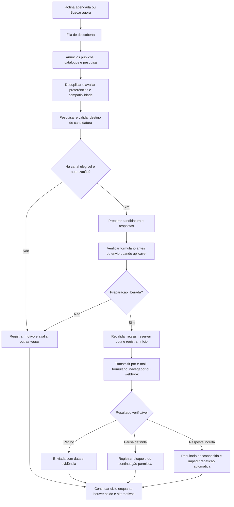

# Mapeamento completo das tentativas de envio automático

Data do levantamento: **23/10/2026**. Horários mencionados: Brasília, salvo indicação de UTC.

## 1. Resposta direta: como estou tentando fazer o envio

A estratégia implementada é buscar vagas reais, conferir compatibilidade com o perfil e as preferências aprovadas, localizar um canal de candidatura verificável e colocar a candidatura em uma fila. Um executor transmite o currículo por esse canal e só registra sucesso quando recebe uma confirmação.

Os canais implementados são:

1. **E-mail pelo Gmail conectado**, quando o anúncio publica um endereço de candidatura validável.
2. **Formulário nativo da empresa**, para o modelo de formulário WP Jobs Board reconhecido pelo projeto e domínio autorizado.
3. **Navegador automatizado com Playwright**, local ou em Vercel Sandbox, para formulários e portais suportados.
4. **Integração externa por webhook**, se configurada e autorizada, com exigência de recibo.

Não existe hoje evidência de um executor universal capaz de concluir qualquer candidatura. Há caminhos que funcionaram e caminhos que continuam bloqueando. A meta configurada de cinco envios diários não foi atingida no último diagnóstico salvo.

## 2. Escopo e grau de certeza deste documento

Este levantamento foi feito por leitura do código, das configurações versionadas, dos relatórios anteriores e das evidências locais. Não foram lidos valores de segredos para compor o documento.

- **Código observado:** descreve a implementação presente na pasta de trabalho em 23/10/2026. A pasta contém alterações locais; não se presume que todo arquivo seja idêntico ao deployment de produção.
- **Resultado histórico:** descreve o que os registros salvos de produção documentam, principalmente em 22/10/2026.
- **Ponto pendente:** depende de nova inspeção ou execução para ser confirmado.

Nesta elaboração não executei novas candidaturas, não publiquei mudanças e não consultei o estado atual da conta em produção. A execução agendada para 23/10 às 08h aparece como próxima execução no snapshot de 22/10; isso não comprova que ocorreu.

## 3. Fluxo completo

O ciclo percorre um conjunto finito de oportunidades disponíveis. Não significa pesquisar a internet indefinidamente até preencher a meta.

## 4. O que inicia a rotina

| Origem | Entrada | Comportamento observado no código |
| --- | --- | --- |
| Agendamento Vercel | `api/daily-routine.mjs` e `server/vercel-cron.ts` | Autentica o cron, inicia rotinas vencidas e recupera tarefas pendentes. |
| Buscar agora | `POST /api/discover` | Cria ou utiliza tarefa persistida de descoberta para a conta autenticada. |
| Ativar ou atualizar automação | `PUT /api/routine` | Valida disponibilidade, limita a cota pelo plano, salva a rotina e processa candidaturas elegíveis. |
| Processar vagas existentes | `POST /api/routine/process` | Prepara vagas já disponíveis e continua o ciclo. Pode receber um `jobId` explícito. |
| Envio individual | `POST /api/applications/:appId/send` | Usa autorização individual; deve ser distinguido da rotina automática. |

Na configuração Vercel, o cron é `0 11 * * *`: 11h UTC, equivalentes a **08h em Brasília** na data deste levantamento. `scheduledTime()` fixa 08h quando o caminho Vercel Queue está ativo. O cron não está configurado para verificar a cada minuto.

Fora desse caminho, existe agendamento BullMQ/Redis com fuso `America/Sao_Paulo`. Sem Redis, há também scheduler local que verifica rotinas vencidas a cada 60 segundos enquanto o processo está ativo.

**Implicação:** uma rotina local depende do processo em execução; uma rotina em nuvem depende da infraestrutura, cron, filas e configuração publicados. Manter a tela aberta não é o mecanismo principal da execução em nuvem.

## 5. Como as vagas são encontradas

A descoberta é coordenada em `server/operations.ts`, com tarefas em `server/discovery-queue.ts`.

As opções presentes incluem fontes públicas e conectores, catálogos de ATS, pesquisa de páginas oficiais, pesquisa específica de vagas com e-mail, publicações de empregadores, quadros de vagas de empresas e descoberta Abler.

### Abler

`server/abler-discovery.ts` consulta o sitemap público e escolhe páginas relacionadas aos títulos desejados. O código examina até **120 URLs selecionadas**, duas por vez, dentro do orçamento de tempo disponível.

Para aceitar um anúncio, verifica identidade da vaga, empresa, status em andamento, data original de publicação, eventual encerramento e o endereço de candidatura explicitamente publicado nos dados públicos da página.

O endereço não é inventado a partir do identificador. O campo publicado precisa existir e corresponder à vaga. O `lastmod` do sitemap serve para selecionar páginas a consultar; não substitui a data original de publicação.

**Limite:** até 120 páginas selecionadas não representa leitura de todas as vagas da plataforma. Filtros por título, data e tempo de execução reduzem o conjunto efetivamente examinado.

### Pesquisa com IA

Pesquisa e análise auxiliam a encontrar e interpretar oportunidades. Um link retornado pela pesquisa é uma pista: a publicação e o destino ainda precisam de validação. Disponibilidade de Gemini/Antigravity não é prova de que um currículo foi enviado.

## 6. Como uma vaga se torna elegível

Antes de enfileirar e novamente antes de transmitir, o motor verifica regras como:

- Conta real, perfil confirmado e dados necessários para candidatura preenchidos.
- Currículo aprovado, associado às preferências concluídas quando aplicável.
- Arquivo original disponível quando exigido pelo canal; há exceções específicas para perfil pronto em determinados portais.
- Vaga disponível, não descartada e compatível com os sites selecionados.
- Cargos, filtros objetivos, pontuação mínima e confiança suficiente na avaliação.
- Destino válido e canal de envio autorizado.
- Ausência de envio anterior ou tentativa incerta para a mesma oportunidade/destino.
- Saldo dentro do menor limite entre a rotina e o plano.

Há regras específicas para dados ausentes autorizados e para retomadas de formulários. Elas não devem ser interpretadas como liberação geral de todos os filtros.

No último snapshot salvo, a rotina estava com **pontuação mínima 70**, **limite diário 5** e política de destinos **`official`**. Os relatórios anteriores registram a preservação da janela de 14 dias. Esses valores são configuração histórica da conta, não constantes universais do produto.

Arquivos centrais: `server/engine.ts`, `server/submission-eligibility.ts`, `server/submission-consent.ts`, `server/missing-data-consent.ts` e `queuePreparedApplications()` em `server/operations.ts`.

## 7. Como o destino é escolhido

A ordem observada em `server/submission-routing.ts` é:

1. E-mail validado da vaga, com configuração Google OAuth disponível.
2. Gateway/webhook autorizado para a empresa ou portal, conforme as regras da fonte e da política de destinos.
3. Destino independente verificado, com formulário encontrado, validade vigente e execução permitida.
4. Navegador de portal conectado, quando a política de destinos permite esse caminho e a resolução da vaga está presente.

Com `destinationPolicy: official`, a função não segue para o último fallback de sessão nativa. O e-mail validado continua sendo considerado antes dessa restrição.

**Atenção de implementação:** a existência de configuração Google permite selecionar a rota de e-mail, mas não comprova que o Gmail daquele usuário esteja conectado e utilizável. Isso é verificado durante a execução. Além disso, a ativação da rotina em `PUT /api/routine` exige disponibilidade de execução independente para a política `official`; uma instalação somente com Gmail pode esbarrar nessa validação. É um ponto identificado por leitura, sem nova reprodução nesta análise.

## 8. Como o envio é executado em cada canal

### 8.1. Gmail

`server/email-application.ts`:

1. Revalida a publicação e o destinatário fixado.
2. Obtém um token Gmail da conta conectada.
3. Monta uma mensagem MIME com assunto da vaga, apresentação e currículo original anexado.
4. Executa um `POST` em `gmail/v1/users/me/messages/send`.
5. Exige um identificador de mensagem válido na resposta para gerar o recibo.

O anexo aceito por esse módulo é PDF ou DOCX, com até 5 MiB. A chamada de envio tem timeout de 25 segundos.

Recibo: `Gmail message ID: ...`.

**O que comprova:** o Gmail aceitou a mensagem. Não comprova entrega na caixa do empregador, leitura ou avanço no processo seletivo.

Se a resposta se perde depois do início, o resultado é desconhecido. Recusas explícitas, como certos HTTP 400/401/403/404/413/429, são registradas para revisão. Não há repetição cega da mensagem.

### 8.2. Formulário nativo da empresa

`server/company-form.ts`, acionado por `server/ats-execution.ts`, implementa o adaptador WP Jobs Board.

Ele reabre a página, confirma URL, título, empresa e estrutura do formulário, preserva campos do formulário e envia nome, e-mail, apresentação e arquivo por `multipart/form-data`.

O envio só recebe status de sucesso se a resposta apresentar uma mensagem positiva nova, ausente no conteúdo anterior. O recibo inclui a frase observada e um resumo SHA-256 da resposta HTML.

O hash identifica a resposta usada como evidência; não é um protocolo de candidatura emitido pelo empregador.

**Limite:** esse adaptador reconhece um modelo específico. Encontrar qualquer formulário em um site de empresa não torna esse site automaticamente compatível.

### 8.3. Navegador independente para ATS

`server/ats-registry.ts` reconhece diversas plataformas, mas a permissão de execução independente está restrita a Greenhouse, Lever, Ashby, SmartRecruiters e formulários de empresa autorizados. Reconhecer uma URL de Gupy, Pandapé ou Workday não significa que essa rota saiba enviá-la.

`server/ats-execution.ts` pode executar:

- Playwright local, com `ATS_EXECUTION_LOCAL=true` fora da Vercel.
- Navegador em Vercel Sandbox a partir de `PORTAL_CLOUD_SNAPSHOT_ID`.
- O adaptador nativo de empresa, sem navegador, quando a evidência do formulário WP Jobs Board está presente.

O navegador verifica bloqueios, login, campos e perguntas. A preparação `inspectOnly` não preenche campos, não anexa currículo e não clica em enviar. Depois da liberação, o executor preenche dados conhecidos, anexa o arquivo, submete e procura confirmação no destino.

CAPTCHA, verificação humana, login obrigatório ou campos sem solução podem impedir a conclusão. Falta de infraestrutura impede até mesmo abrir o formulário.

### 8.4. Sessões de portais

`server/portal-application.ts` contém regras para LinkedIn, Gupy, InfoJobs e Glassdoor; Gupy tem fluxo próprio em `server/gupy-application.ts`. Há suporte relacionado a sessão de navegador, nuvem e extensão Chrome no projeto.

A candidatura depende da sessão autenticada, do perfil pronto, do tipo de formulário e da política de roteamento. Ter código ou uma conexão de portal não comprova candidatura automática concluída.

Os relatórios de 22/10 não demonstram funcionamento universal de LinkedIn/Gupy. Envios assistidos e envios individuais anteriores não devem ser usados como prova de execução autônoma agendada.

### 8.5. Webhook

O servidor transmite um payload para uma integração externa configurada, incluindo identificação da candidatura, vaga, perfil e currículo. Usa autenticação Bearer e `Idempotency-Key` com o ID da candidatura.

Para confirmar sucesso, a resposta deve trazer `status: sent`, recibo não vazio e identificação compatível quando informada. Uma resposta HTTP positiva sem esse contrato não basta. A comprovação depende do recibo fornecido pela integração.

## 9. Perguntas e uso da IA

Com a política de respostas automáticas confirmada:

1. O servidor prioriza respostas já aprovadas e dados confirmados do perfil.
2. Usa currículo e preferências para preparar respostas adicionais.
3. Pode chamar Gemini se a configuração estiver habilitada e consentida.
4. Para informação ausente, aplica a regra autorizada de resposta negativa; para perguntas pessoais, prioriza a alternativa de não informar.
5. Mantém as respostas vinculadas ao currículo e ao destino de candidatura.

**Consequência prática:** falta de evidência pode gerar “Não”, “0” ou “Prefiro não informar”, conforme o campo e as opções. Isso não equivale a uma informação factual confirmada pelo currículo; pode reduzir a chance da candidatura. Respostas confirmadas incompatíveis com as opções não são simplesmente substituídas por uma negativa.

Aceites jurídicos/privacidade são excluídos da geração automática genérica; dependem das autorizações específicas reconhecidas pelo sistema.

Se surgir uma nova pergunta antes da submissão e o executor afirmar que a pausa permite retomada, o servidor pode preparar respostas e executar até **quatro rodadas adicionais**. Perguntas repetidas sem progresso encerram a continuação. Resultado desconhecido não entra nesse mecanismo.

Arquivos: `server/automatic-answers.ts`, `server/automatic-answer-fallback.ts`, `server/question-drafts.ts`, `server/approved-answers.ts` e `completeQuestions()` em `server/operations.ts`.

## 10. Filas, continuidade e recuperação

Na Vercel há três tópicos:

| Tópico | Função |
| --- | --- |
| `empregatos-discovery` | Busca e incorporação de vagas. |
| `empregatos-destinations` | Pesquisa e validação dos destinos. |
| `empregatos-submissions` | Execução das candidaturas preparadas. |

O `vercel.json` configura funções desses workers com até 300 segundos, concorrência máxima de duas entregas por tópico e até cinco entregas por mensagem. A recuperação de mensagens não significa autorização para transmitir novamente uma candidatura já iniciada.

`server/submission-dispatch.ts` usa chave de idempotência por candidatura, tamanho do histórico e dia. O worker confere o estado persistido antes de executar, e o envio é reivindicado em transação antes da chamada externa.

A pesquisa de destinos trabalha em lotes de até quatro vagas, com duas consultas públicas simultâneas no fluxo geral. Prioriza pedidos explícitos, vagas acima da pontuação mínima e distribuição entre empresas.

A antiga limitação de vinte verificações deixou de encerrar o ciclo automático. No modo automático, `researchAllowance()` considera o conjunto ainda elegível; o orçamento manual de diagnóstico continua separado.

`continueAutomaticCycle()` decide entre enviar, aguardar busca em andamento, aguardar pesquisa de destino, iniciar outro lote ou registrar que faltam alternativas viáveis. Não promete completar a cota quando não há mais vagas elegíveis.

Durante um envio há atualização de atividade a cada 30 segundos. Uma candidatura em `Enviando` sem atualização por pelo menos 150 segundos pode ser recuperada como `Resultado desconhecido`, para impedir repetição sem confirmação.

## 11. Estados internos e o que aparece na tela

| Estado | Significado | É envio confirmado? |
| --- | --- | --- |
| `Aguardando aprovação` | Nome técnico do estado usado também pela fila automática preparada. Não implica necessariamente espera por clique humano no modo automático. | Não |
| `Enviando` | O servidor registrou o início e aguarda resultado. | Não |
| `Requer ação manual` | Há bloqueio, informação pendente, recusa ou pausa definida. | Não |
| `Falha no envio` | A integração afirmou explicitamente que não submeteu. | Não |
| `Resultado desconhecido` | Pode ter havido submissão, mas não existe confirmação recuperada. | Não |
| `Enviada` com recibo e data válidos | O canal forneceu a confirmação exigida. | Sim, no alcance do canal |

`shared/confirmed-applications.ts` exige recibo não vazio, data de envio e data parseável. `src/pages/Applications.tsx` usa esse critério para mostrar o histórico.

Portanto, uma tela com poucos envios pode coexistir com várias tentativas internas. Essas tentativas continuam armazenadas para diagnóstico e prevenção de duplicidade.

Há uma rota de confirmação de ausência de submissão, `POST /api/applications/:appId/confirm-not-submitted`, para situações elegíveis. Ela exige confirmação explícita e motivo, não confirma sucesso e não reinicia o envio por si só.

## 12. Cota, limpeza e duplicidade

O sistema mantém uso persistente em `applicationUsage`, além de examinar o histórico das candidaturas. A continuação considera o maior uso relevante para não liberar saldo indevidamente.

- Envio confirmado consome cota.
- Tentativa incerta mantém a proteção e pode manter cota reservada/utilizada.
- Pausa comprovada antes da submissão pode liberar reserva conforme o estado de retomada.
- Bloqueio na preparação anterior à reserva não é envio e não deve consumir essa reserva.
- Limpar o histórico não cancela candidaturas recebidas por empregadores nem zera o uso persistente.
- A limpeza preserva impressões de oportunidades enviadas ou iniciadas para impedir reaplicação automática.

**Meta, enviados e cota usada são medidas diferentes.** O saldo de três no snapshot não significa que bastavam três sucessos para a tela mostrar cinco: um uso anterior à limpeza já não estava no histórico visível.

Arquivos: `server/billing.ts`, `server/submission-attempts.ts`, `server/job-identity.ts` e `server/clear-application-history.ts`.

## 13. O que foi comprovado nos registros disponíveis

### AllEasy — formulário oficial

O relatório `DIAGNOSTICO-AUTOMACAO-2026-10-22.md` e as evidências locais registram:

- Vaga: Desenvolvedor(a) .Net Sênior — AllEasy.
- Publicação: 13/10/2026; pontuação registrada: 77.
- Preparação pelo sistema: 22/10 às 10h17min29s.
- Início: 10h17min58s; confirmação: **10h18min10s**.
- Caminho: descoberta geral, fila e adaptador nativo do formulário da empresa.
- Recibo: `Formulário da empresa: candidatura foi enviada [resposta 583f8048644ed030]`.

O registro descreve envio automático após busca geral, sem seleção individual da vaga. Não comprova cinco envios nem a execução do cron do dia seguinte.

### Solucionare — Gmail

O snapshot `artifacts/cycle-after-continuation-2026-10-22.json` registra:

- Vaga: Analista de Sistemas Sênior — Solucionare.
- Caminho: anúncio Abler com canal específico de candidatura e envio Gmail.
- Confirmação: **22/10 às 12h51min15s**.
- Status: `Enviada`; recibo: `Gmail message ID: 1a1644f34c558e49`.

Isso comprova aceitação da mensagem pelo Gmail, sem comprovar leitura ou entrega final ao recrutador.

### Último snapshot consolidado

O arquivo está datado de **22/10/2026 às 16h25min24s**, após a limpeza de histórico e a continuação da rotina:

| Medida | Valor registrado |
| --- | --- |
| Rotina | Ativa, automática, às 08h |
| Meta diária | 5 |
| Pontuação mínima | 70 |
| Vagas armazenadas | 423 |
| Vagas com pesquisa registrada | 68 |
| Vagas elegíveis restantes para pesquisa | 0 |
| Envios confirmados no histórico atual do dia | 1 |
| Usos persistentes da cota | 2 |
| Saldo de cota | 3 |
| Estado | `waiting` |
| Tentativas CI&T presentes | 4, todas bloqueadas por verificação humana antes do envio |

Os quatro registros CI&T incluem Angular, .NET Senior e .NET/Next.js. Todos estão sem recibo. A mensagem final informa que os destinos disponíveis foram verificados e ainda havia saldo.

Os dois sucessos históricos descritos acima ocorreram em momentos diferentes do histórico, com uma limpeza entre eles. Não devem ser apresentados como dois registros simultaneamente visíveis no snapshot final, nem como meta de cinco cumprida.

## 14. Tentativas de correção já documentadas

| Problema encontrado | Ação registrada | Alcance da evidência |
| --- | --- | --- |
| Pesquisa concentrada na CI&T/Lever | Distribuir verificações entre empresas, considerando lotes anteriores. | Código e relatório; não elimina CAPTCHA. |
| Pontuação alta para especialidades divergentes | Recalcular pela descrição completa e tecnologias do título. | Reproduções anteriores registraram redução de pontuações inadequadas. |
| Mensagem genérica de falta de destinos | Distinguir verificação humana, perguntas e esgotamento das alternativas. | Implementação presente. |
| Poucos canais concluíveis | Buscar anúncios oficiais com e-mail, publicações de empregadores e formulário WP Jobs Board. | Há recibos de formulário e Gmail registrados. |
| Abler ainda sem descoberta dedicada | Adicionar sitemap e validação do e-mail publicado. | Há envio Solucionare documentado pelo Gmail. |
| Ciclo encerrando em vinte verificações | Percorrer o conjunto elegível em lotes até esgotá-lo ou usar a cota. | Snapshot posterior mostra 68 pesquisas. |
| Limpeza podendo criar saldo aparente | Consultar uso persistente e preservar exclusões de oportunidades. | Snapshot final mantém dois usos após limpeza. |
| Pouca cobertura de coleta Abler | Ampliar seleção para até 120 páginas correspondentes, em pares. | Código e publicação anterior documentados; não assegura vagas novas compatíveis. |
| Pendências confundidas com sucesso | Mostrar apenas candidaturas com recibo e data válidos. | Critério compartilhado e tela presentes. |

Relatórios anteriores citam testes e builds aprovados para essas entregas. Esses são resultados históricos; não rodei novamente a suíte para produzir este mapeamento documental.

## 15. Por que o objetivo ainda não foi cumprido integralmente

O último cenário observado não estava parado no antigo limite de vinte pesquisas: percorreu 68 registros e terminou sem vagas elegíveis restantes para pesquisar. As candidaturas adicionais que chegaram à preparação encontraram verificação humana.

As limitações se distribuem por etapa:

| Etapa | Limitação | Efeito |
| --- | --- | --- |
| Descoberta | Fontes, consultas, quotas e seleção finita de páginas. | Nem toda oportunidade existente entra no conjunto. |
| Compatibilidade | Filtros e pontuação mínima aprovados. | Muitas vagas encontradas não podem seguir. |
| Destino | Link não confirmado, validade vencida ou canal não suportado. | Vaga compatível pode continuar sem envio. |
| Preparação | CAPTCHA, login, perguntas e aceites pendentes. | Destino encontrado não vira candidatura concluída. |
| Infraestrutura | Snapshot, sessão, token, API, autenticação ou worker indisponível. | O executor pode não iniciar ou terminar. |
| Confirmação | Resposta perdida ou mensagem de sucesso ausente. | Resultado fica desconhecido e não é repetido automaticamente. |
| Continuidade | Conjunto elegível esgotado mesmo com saldo. | A rotina aguarda a próxima busca. |

O relatório de retomada de 22/10 também registra bloqueio do uso de Chrome pela configuração do aplicativo, resposta 401 à credencial local de cron e recusa de identidade federada de desenvolvimento. Isso explica a impossibilidade de disparar/acompanhar uma etapa naquela ocasião; não prova falha de todos os workers de produção. A etapa seguinte acabou registrada em evidências posteriores.

**Conclusão técnica:** há envio automático real por canais específicos. A cobertura e a capacidade de concluir formulários restantes ainda não sustentam a promessa de cinco envios diários para este perfil.

## 16. Configurações que controlam o mecanismo

Somente nomes são listados aqui. A existência no código não confirma o valor atual em produção.

| Configuração | Papel |
| --- | --- |
| `VERCEL_QUEUES_ENABLED` | Pode desativar o caminho de filas Vercel. |
| `REDIS_URL` | Ativa a alternativa de fila/agendamento Redis. |
| `API_UPSTREAM_ORIGIN` | Influencia o uso do caminho Vercel Queue local. |
| `CRON_SECRET` | Autentica o disparo do cron. |
| `DATABASE_PROVIDER`, `DATABASE_URL` | Selecionam persistência conforme a instalação. |
| `PORTAL_CLOUD_SNAPSHOT_ID` | Define a imagem do navegador de nuvem. |
| `ATS_EXECUTION_LOCAL` | Permite navegador independente local fora da Vercel. |
| `ATS_PUBLIC_FORM_PLATFORMS` | Habilita plataformas públicas suportadas. |
| `ATS_BROWSER_AUTHORIZED` | Autoriza boards/domínios específicos para execução. |
| `COMPANY_FORM_AUTHORIZED` | Autoriza domínios de formulário de empresa. |
| `DISCOVERY_ATS_BOARDS` | Define catálogos de ATS para descoberta. |
| `DISCOVERY_COMPANY_BOARDS` | Define quadros de vagas de empresas. |
| `ABLER_EMAIL_DISCOVERY_ENABLED` | Habilita descoberta Abler dedicada. |
| `DESTINATION_RESEARCH_DAILY_LIMIT` | Orçamento de diagnóstico fora do ciclo automático descrito. |
| `APPLICATION_WEBHOOK_AUTHORIZED`, `APPLICATION_WEBHOOK_URL`, `APPLICATION_WEBHOOK_TOKEN`, `APPLICATION_WEBHOOK_PORTALS` | Controlam o gateway externo de candidatura. |

Além dessas variáveis, existem estados por usuário: conexão Gmail, sessões dos portais, consentimentos, assinatura, perfil, currículo aprovado e política de respostas. Nenhuma variável isolada substitui esses estados.

## 17. Mapa dos arquivos para manutenção

| Responsabilidade | Arquivos principais |
| --- | --- |
| Entradas da API | `server/app.ts` |
| Agendamento | `vercel.json`, `server/vercel-cron.ts`, `server/queue.ts`, `server/worker.ts` |
| Disponibilidade do runtime | `server/automation-runtime.ts` |
| Descoberta e worker | `server/discovery-queue.ts`, `server/vercel-worker.ts`, `server/operations.ts` |
| Fontes | `server/connectors.ts`, `server/official-discovery.ts`, `server/abler-discovery.ts`, `server/employer-feed-discovery.ts`, `server/company-board.ts` |
| Compatibilidade | `server/engine.ts` |
| Pesquisa de destino | `server/resolution-queue.ts`, `server/destination-resolver.ts`, `server/destination-page.ts`, `server/equivalent-search.ts` |
| Preparação e elegibilidade | `server/submission-eligibility.ts`, `server/submission-preparation.ts`, `server/submission-consent.ts` |
| Roteamento | `server/submission-routing.ts`, `server/ats-registry.ts` |
| Continuidade automática | `server/automatic-cycle.ts` |
| Fila de envio | `server/submission-dispatch.ts`, `server/vercel-submission-worker.ts` |
| Orquestração da transmissão | `automaticSend()` em `server/operations.ts` |
| E-mail | `server/email-destination.ts`, `server/email-application.ts`, `server/gmail-connection.ts` |
| Formulário nativo | `server/company-board.ts`, `server/company-form.ts` |
| Navegador ATS | `server/ats-execution.ts`, `server/ats-application.ts`, `server/ats-browser-runner.ts`, `server/ats-network.ts` |
| Portais autenticados | `server/portal-sessions.ts`, `server/portal-application.ts`, `server/gupy-application.ts`, `server/gupy-browser-session.ts`, `browser-extension/gupy-session/` |
| Respostas | `server/automatic-answers.ts`, `server/question-drafts.ts`, `server/approved-answers.ts`, `server/automatic-answer-fallback.ts` |
| Recibo | `server/application-verification.ts`, `shared/confirmed-applications.ts` |
| Cota e proteção | `server/billing.ts`, `server/submission-attempts.ts`, `server/submission-resume.ts`, `server/job-identity.ts` |
| Histórico visível | `src/pages/Applications.tsx`, `src/SimpleAutomation.tsx` |
| Persistência | `server/db.ts`, `server/storage-firestore.ts`, `server/storage-postgres.ts` |
| Limpeza | `server/clear-application-history.ts`, `scripts/clear-owner-history.ts` |

## 18. Evidências locais e leitura complementar

- [Diagnóstico da automação de 22/10](DIAGNOSTICO-AUTOMACAO-2026-10-22.md).
- [Continuação do ciclo e preservação de cota](CONTINUACAO-DA-COTA-2026-10-22.md).
- [Histórico somente com envios confirmados e limpeza](CANDIDATURAS-SOMENTE-ENVIADAS-2026-10-22.md).
- [Documentação de candidaturas por e-mail](CANDIDATURAS-POR-EMAIL.md).
- [Snapshot posterior à continuação](../artifacts/cycle-after-continuation-2026-10-22.json).
- [Snapshot anterior à continuação](../artifacts/cycle-before-continuation-2026-10-22.json).
- [Recibo textual AllEasy](../artifacts/automatic-receipt-confirmed-2026-10-22.txt).
- [Imagem da confirmação AllEasy](../artifacts/automatic-receipt-confirmed-2026-10-22.png).
- [Registro da confirmação Solucionare](../artifacts/automatic-solucionare-receipt-2026-10-22.json).
- [Imagem da confirmação Solucionare](../artifacts/automatic-solucionare-receipt-2026-10-22.jpg).

As evidências são arquivos do projeto e retratam momentos passados. A leitura delas não equivale a uma nova consulta ao empregador ou à produção.

## 19. Próximas verificações necessárias

Estas ações são recomendações de continuidade; não foram executadas nesta entrega documental.

1. Confirmar o que ocorreu na execução prevista para 23/10 às 08h, consultando tarefa, execução de busca, histórico e recibos.
2. Conferir qual revisão está publicada e quais canais estão efetivamente configurados para a conta.
3. Medir a conversão por etapa: encontradas, compatíveis, destino validado, preparação liberada, transmissão iniciada e recibo confirmado.
4. Registrar motivos de bloqueio por canal e empresa, incluindo as tentativas internas que não aparecem na tela de enviados.
5. Ampliar canais oficiais que possam concluir candidaturas para as preferências atuais, com validação de destino e recibo.
6. Validar separadamente cron, descoberta e transmissão. Um teste de formulário isolado não comprova o ciclo agendado inteiro.
7. Demonstrar continuidade em mais de um dia antes de afirmar regularidade diária; registrar também quando a quantidade de vagas ou os bloqueios impedirem atingir a meta.

O critério de conclusão permanece: candidatura elegível, currículo autorizado, transmissão executada pelo canal correto e confirmação registrada no alcance real desse canal.
