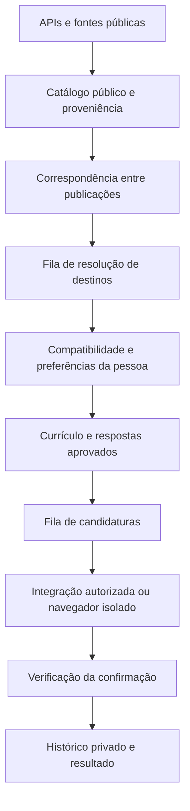

# Motor de descoberta e candidaturas — 16/10/2026

## Resultado e limite da entrega

O motor passou a separar a origem de uma oportunidade do destino de candidatura. Uma vaga descoberta no LinkedIn, InfoJobs ou Glassdoor pode ser vinculada a uma publicação equivalente em outro ATS antes da escolha do caminho de envio. Conectar esses agregadores deixou de ser requisito arquitetural para um destino independente autorizado.

Foi comprovada uma entrega de PDF fictício a um receptor controlado, executando o fluxo do projeto em um Vercel Sandbox real. Também foi comprovado o transporte da pesquisa pela Vercel Queues até uma Function e o Firestore reais. **Nenhuma candidatura a empregador real foi enviada ou comprovada nesta entrega.** Os adaptadores web são implementações iniciais, com validação em formulários controlados; isso não certifica todos os formulários de cada ATS.

## Arquitetura encontrada e mudanças

O projeto real usa React/Vite e Fastify/TypeScript. A instalação publicada usa Vercel Functions, Cron, Queues, Sandbox e Firestore Standard. Não foi necessária migração para Next.js. PostgreSQL e PGlite continuam alternativas existentes.

Foram preservados autenticação do aplicativo, assinaturas/Stripe, arquivos aprovados e cifrados, entrevista, preferências, limites de plano, fila de envio e sessões remotas individuais dos portais. O layout recebeu apenas informações de destino e perguntas pendentes.

O acoplamento anterior escolhia o envio principalmente pela fonte do anúncio e disponibilidade da sessão do portal. A nova ordem é: integração autorizada existente, destino independente verificado e autorizado, depois sessão do portal quando aplicável. O caminho do portal exige que a vaga tenha passado pela pesquisa de destinos. Uma busca incompleta permanece documentada como parcial.

| Responsabilidade | Implementação principal |
| --- | --- |
| Descoberta e cache das fontes | `connectors.ts`, `source-catalog.ts`, `discovery-queue.ts` |
| Identidade e comparação entre publicações | `job-identity.ts` |
| Catálogo público compartilhado e reserva de análise | `opportunity-catalog.ts` |
| Links, dados estruturados, leitura pública e busca | `destination-page.ts`, `public-web.ts`, `equivalent-search.ts` |
| Resolução assíncrona | `destination-resolver.ts`, `resolution-queue.ts`, `vercel-resolution-worker.ts` |
| Compatibilidade com a pessoa | `engine.ts` |
| Preparação e roteamento | `operations.ts`, `submission-routing.ts` |
| Respostas confirmadas | `approved-answers.ts` |
| Execução e rede isolada | `ats-application.ts`, `ats-execution.ts`, `ats-network.ts` |
| Confirmação | `application-verification.ts` |

Cada vaga mantém URL de origem, publicações de proveniência, identificadores, links de candidatura, destinos e auditoria da resolução. A candidatura congela o identificador e URL do destino utilizado. Perguntas, respostas, currículos e resultados ficam na conta da pessoa; a fila transporta identificadores.

As migrations `0010` e `0011` acrescentam catálogo e tarefas para PostgreSQL/PGlite. No Firestore, foram acrescentados mapeamentos, referências, exclusão em cascata por conta e índices correspondentes. Os índices foram aplicados no banco Standard existente; não houve criação de banco alternativo nem ativação de faturamento.

## Descoberta efetivamente consultada

Consultas públicas reais, com URLs de amostra preservadas em [destination-real-discovery.json](../artifacts/destination-real-discovery.json):

| Fonte | Quadro consultado | Anúncios devolvidos |
| --- | --- | ---: |
| Greenhouse | Stripe | 732 |
| Lever | Palantir | 310 |
| Ashby | Notion | 129 |
| SmartRecruiters | BoschGroup | 30 |

Esses números são resultados de consulta, incluindo oportunidades globais. **Não são contagens de vagas compatíveis, empresas parceiras ou candidaturas.** SmartRecruiters foi limitado a 30 detalhes por orçamento. Os quadros adicionais são configuráveis por `DISCOVERY_ATS_BOARDS`; sua validação não os ativa automaticamente em todas as contas.

A consulta pública Gupy existente foi preservada e ganhou cache compartilhado por consulta. As variações de cargo incluem equivalências como React/frontend e backend; senioridade, localidade e requisitos continuam critérios separados. Greenhouse preserva requisição/departamento; os conectores conservam os links publicados de candidatura.

Jooble ganhou conector regional condicionado à chave; não foi validado com credencial real. Adzuna permanece condicionado às credenciais e cobertura autorizada. Workday é reconhecido como destino, sem uso de endpoints privados de submissão. LinkedIn, Glassdoor e InfoJobs continuam sujeitos às possibilidades de descoberta autorizada ou indexação pública; não foi criado scraper que contorne login ou bloqueios.

A consulta externa usa citações do mecanismo de busca de Gemini ou Antigravity. URLs sugeridas no texto de um modelo não bastam. Antigravity permanece restrito ao titular configurado; sua conta não autentica candidatos. Na ausência ou falha do indexador, a auditoria registra pesquisa parcial.

## Correspondência e vaga indicada

O comparador usa empresa normalizada, URL e identificadores oficiais, título, descrição, localização, modalidade, senioridade e departamento quando disponíveis. IDs conflitantes no mesmo quadro e requisições incompatíveis impedem a fusão. Sem identificador suficiente, exige descrição extensa e alta concordância de conteúdo. Publicações ambíguas permanecem separadas. A pontuação é uma regra de evidência, não uma probabilidade estatística; homônimos e descrições reaproveitadas continuam limitações.

Para a vaga InfoJobs `12110291`, de King of Languages, foi identificada uma publicação equivalente:

- [Anúncio no InfoJobs](https://www.infojobs.com.br/vaga-de-desenvolvedora-junior-net,-react-ia-em-__12110291.aspx).
- [Publicação no Pandapé da empresa](https://kingoflanguages.pandape.infojobs.com.br/Detail/3817540).

Foi comprovado **um par de publicações equivalentes e um destino alternativo** neste caso real. Título e descrição coincidiram nas regras do comparador. A verificação final seguiu os links efetivamente publicados: anúncio → perfil da empresa → site/quadro da empresa → anúncio Pandapé. Não precisou de indexador ou IA para encontrar esse destino. A evidência está em [destination-link-chain.json](../artifacts/destination-link-chain.json).

Uma inspeção adicional do botão de candidatura abriu a etapa de e-mail em `/ApplyCT/3817540`. Nenhum dado pessoal foi preenchido. O resolver estático identifica a publicação, mas **não marca essa página como formulário pronto**. Pandapé permanece assistido e não tem adaptador automático habilitado. Evidências: [inspeção](../artifacts/pandape-form-inspection.json) e [imagem](../artifacts/pandape-destination-inspection.png).

## Candidaturas, autorização e confirmação

Foram implementadas regras iniciais de formulário para Greenhouse, Lever, Ashby e SmartRecruiters, além de um contrato explícito de formulário de empresa. O executor exige publicação/destino atual, empresa/cargo reconhecidos, formulário único, campo de currículo, dados confirmados e campos obrigatórios resolvidos. Só envia nos quadros ou domínios declarados em `ATS_BROWSER_AUTHORIZED`. Essa configuração registra uma autorização existente; preencher a variável não cria autorização do empregador.

Uma API pública de consulta não foi tratada como licença de submissão. Por exemplo, a [documentação Greenhouse](https://docs.greenhouse.io/job-board.html) distingue GET público do POST autenticado. Também foram consultadas as documentações de [Lever](https://github.com/lever/postings-api), [Ashby](https://developers.ashbyhq.com/docs/public-job-posting-api) e [SmartRecruiters](https://developers.smartrecruiters.com/docs/posting-api).

Os navegadores independentes usam Sandbox efêmero, sem cookies de outro candidato. O currículo original é carregado no servidor e a máquina é encerrada ao terminar. O acesso fica restrito à origem verificada, com bloqueio de redes privadas, redirecionamentos externos e terceiros. A leitura pública valida HTTPS, DNS e cada redirecionamento; fixa o IP da conexão. Chromium também recebe a resolução de host validada.

Perguntas desconhecidas geram intervenção. As respostas podem ser confirmadas e reutilizadas em perguntas iguais, no escopo aprovado; declarações sensíveis ficam restritas à vaga. Não há inferência livre de qualificações ou aceitação automática de termos. A primeira versão conserva a tentativa interrompida no histórico e encaminha sua conclusão ao destino; salvar respostas não repete silenciosamente esse envio. Respostas ficam disponíveis para próximas candidaturas compatíveis.

Somente uma confirmação visível do destino, observada depois da submissão, gera recibo de envio automático. Um clique ou HTTP 200 não prova recebimento. Uma interrupção após a tentativa gera `Resultado desconhecido`, bloqueando repetição automática. Uma confirmação observada não é apresentada como identificador de candidatura emitido pelo fornecedor. O registro manual existente continua identificado como confirmação da pessoa.

Gupy e InfoJobs mantêm o adaptador de sessão existente. Glassdoor mantém login/verificação assistida conforme disponibilidade do portal. Não há evasão de CAPTCHA, uso de sessão alheia ou garantia de login social.

## Filas, isolamento e operação

Há três etapas separadas: descoberta, resolução (`empregatos-destinations`) e submissão (`empregatos-submissions`). As tarefas de resolução têm reserva persistente, token de posse e recuperação após expiração. Entregas duplicadas não podem sobrescrever o resultado de outro worker. A consulta pública é reaproveitada entre contas sem copiar compatibilidade pessoal ou candidaturas.

A resolução usa até oito páginas e 45 segundos por vaga por padrão; cada tarefa trata até quatro vagas. O orçamento diário padrão é 20 e também respeita o limite escolhido pela pessoa. A rotina continua em outra tarefa enquanto houver orçamento; uma análise manual prioriza a vaga solicitada mesmo com a rotina pausada. Falhas de indexação ou orçamento insuficiente geram pesquisa parcial e reavaliação, não uma declaração de impossibilidade.

O Cron e o despachante existentes permanecem. Pausa, modo de descoberta, currículo aprovado, perfil confirmado, filtros estritos, limites do plano, reserva de uso e proteção contra duplicidade continuam verificados no envio. A pesquisa pode enriquecer dados desconhecidos, mas não flexibiliza os critérios finais da candidatura.

## Validação e evidências

Validação final desta implementação:

| Verificação | Resultado |
| --- | --- |
| `npm run typecheck` | Passou |
| `npm test -- --maxWorkers=1 --hookTimeout=60000` | 427 passaram, 11 ignorados; 52 arquivos passaram e um foi ignorado |
| `npm run build` | Passou; frontend e Functions gerados; verificação não encontrou segredo configurado no frontend |
| Playwright: `portal-adapters`, `assisted-applications`, `redesign-integration` | 21 passaram, contra build local de produção |
| Pipeline controlado em Sandbox real | Passou às 17:09 de Brasília; arquivo e candidato fictícios corretos, uma recepção, duplicidade rejeitada, contas isoladas |
| API autenticada → Queues → Function → Firestore reais | Passou às 17:13 de Brasília; destino Pandapé registrado; nenhuma candidatura criada; conta QA excluída |
| `/api/health` no deployment validado | HTTP 200, `Cloud Firestore` |

Os testes incluem correspondências falsas, IDs conflitantes, dados geográficos desconhecidos, login na origem, pesquisa parcial, SSRF, resposta aprovada, pergunta não respondida, declaração legal, confirmação ausente, reentrega concorrente, reserva expirada e reutilização do catálogo entre contas. Os 11 testes ignorados não são contabilizados como validações executadas.

Deployment validado: `dpl_5YMEQgqcg99FwULspoH37smUL6p2`, em `curriculoautomatico-qfkc9cbqr-geans-projects-da7db03c.vercel.app`. A consulta à configuração de produção não encontrou `ATS_BROWSER_AUTHORIZED` nem `DISCOVERY_ATS_BOARDS`; portanto, os adaptadores independentes não estão liberados globalmente para envios e os quadros da amostra não foram ativados em massa. Sessões e integrações anteriores conservam suas próprias condições.

Após as verificações, esse deployment foi promovido para [curriculoautomatico.vercel.app](https://curriculoautomatico.vercel.app). A inspeção do domínio confirmou o identificador e a rota de saúde voltou a responder com Firestore. O registro da publicação está em [destination-release-verification.json](../artifacts/destination-release-verification.json). O relatório e os artefatos permanecem no repositório; o deployment contém a aplicação validada.

O teste [controlled-cloud-destination-pipeline.json](../artifacts/controlled-cloud-destination-pipeline.json) executa descoberta → persistência → resolução → preparação → navegador → confirmação → registro em **Linux no Vercel Sandbox real**, com PGlite temporário. Confere igualdade do PDF, identificação fictícia correta, uma recepção, rejeição de duplicidade e isolamento da segunda conta. Nesse teste os consumidores das filas são chamados pelo script; o transporte Vercel Queues não participa.

O teste [destination-queue-verification.json](../artifacts/destination-queue-verification.json) usa rotas autenticadas, Vercel Queues, Function publicada e Firestore Standard reais, com conta QA descartável excluída ao terminar. Não carrega currículo nem envia candidatura. Ele complementa o teste de transmissão do PDF; os dois ensaios **não equivalem a uma candidatura completa de empregador pela infraestrutura de produção**.

Na consulta publicada, a busca adicional pelo indexador falhou e ficou registrada como parcial, embora o destino Pandapé tenha sido verificado pelos links publicados. Essa execução não prova disponibilidade do indexador para todos os assinantes.

## Custos e escala

- APIs públicas e cache reduzem consultas repetidas; não eliminam limites dos fornecedores.
- Firestore consome leituras, escritas, armazenamento e índices. Cada oportunidade e tarefa têm custo; as gravações do catálogo têm concorrência limitada.
- Vercel Functions/Queues consomem execução e entregas. Retentativas e fan-out precisam ser acompanhados.
- Sandbox consome CPU, memória, duração e snapshots. Sessões interativas existentes podem custar mais que tentativas efêmeras.
- Gemini/grounding e Antigravity dependem de cotas e disponibilidade próprias. Cota de IA não substitui computação do navegador.
- Limites técnicos e cache são controles de uso, não uma previsão de custo mensal. Não foi realizada medição de carga com muitos assinantes nem estimativa financeira baseada em volume real.

O armazenamento privado por conta continua com limite de 2.000 vagas. A filtragem ainda lê coleções por conta; o novo catálogo público não remove esse gargalo. A implementação não afirma escala ilimitada. PostgreSQL/Redis separados, alta concorrência e falhas prolongadas dos fornecedores não foram ensaiados nesta entrega.

## Pendências que dependem de acesso ou validação externa

1. Obter uma recepção comprovada por empregador real com o candidato autenticado, o currículo aprovado selecionado e um destino autorizado. A instrução de usar a conta do usuário é respeitada pelo vínculo com a sessão autenticada; não foi escolhida outra pessoa no banco para preencher essa lacuna.
2. Validar cada família de formulário em destinos reais autorizados. Formulários dinâmicos, iframes, serviços externos de upload, múltiplas etapas e Workday/Pandapé podem exigir adaptador adicional ou conclusão assistida.
3. Configurar credenciais de Jooble/Adzuna quando contratadas e os quadros públicos relevantes para o público atendido. Não há autorização global automática de envio a empresas.
4. Validar a disponibilidade do indexador para as contas de produção e monitorar pesquisas parciais. Um destino publicado identificado continua útil mesmo quando a busca adicional falha.
5. Medir custo e latência por conta antes de aumentar orçamento diário e concorrência.

Nenhuma dessas pendências é representada como sucesso fictício no painel ou nos artefatos.
